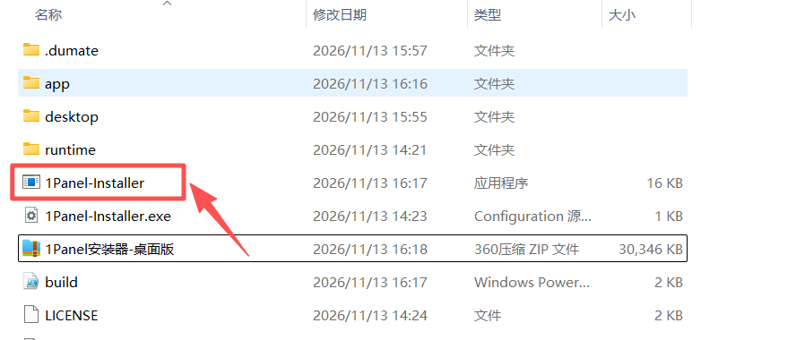
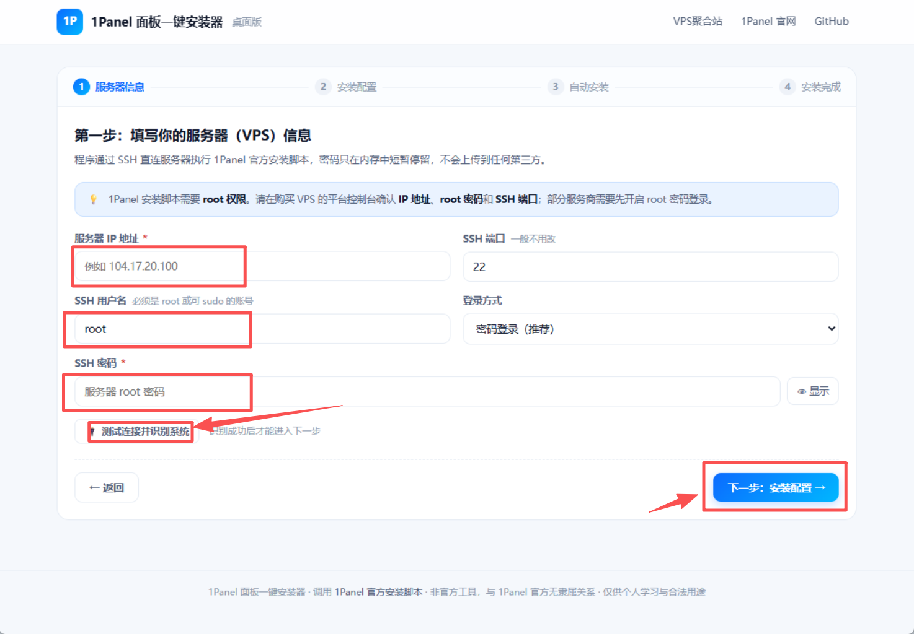
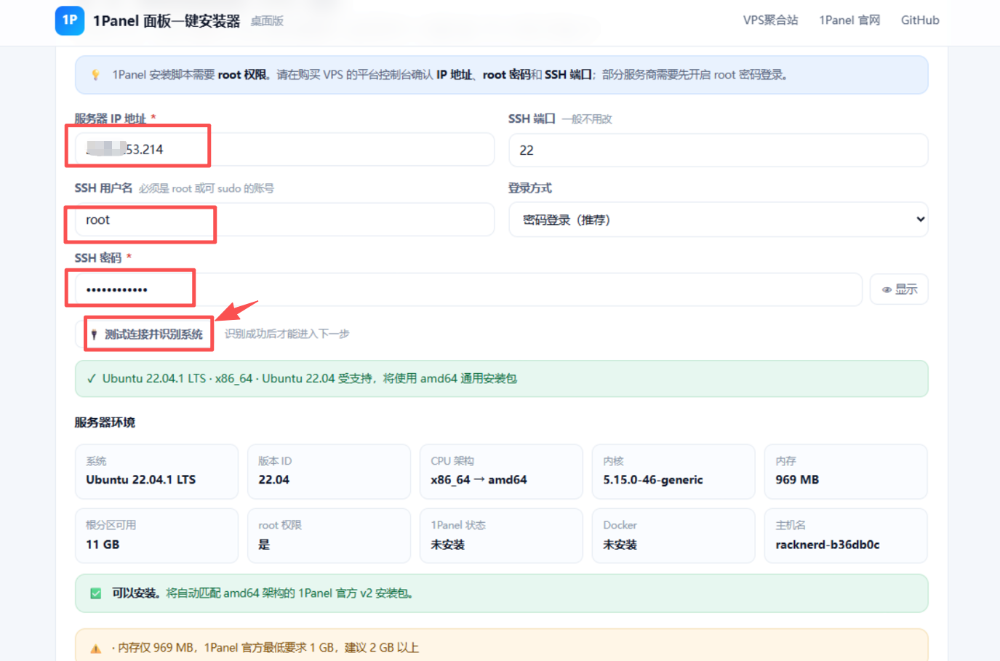
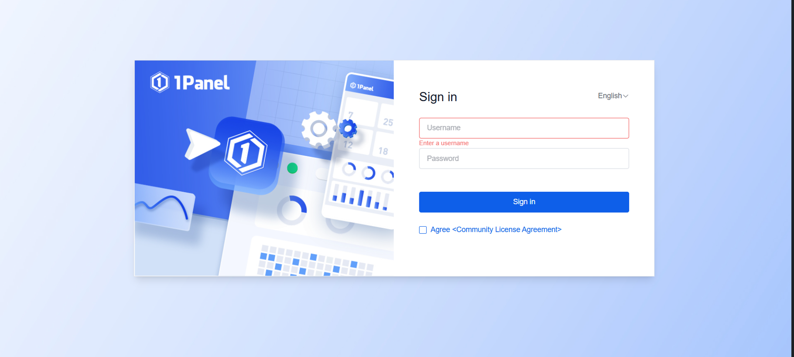
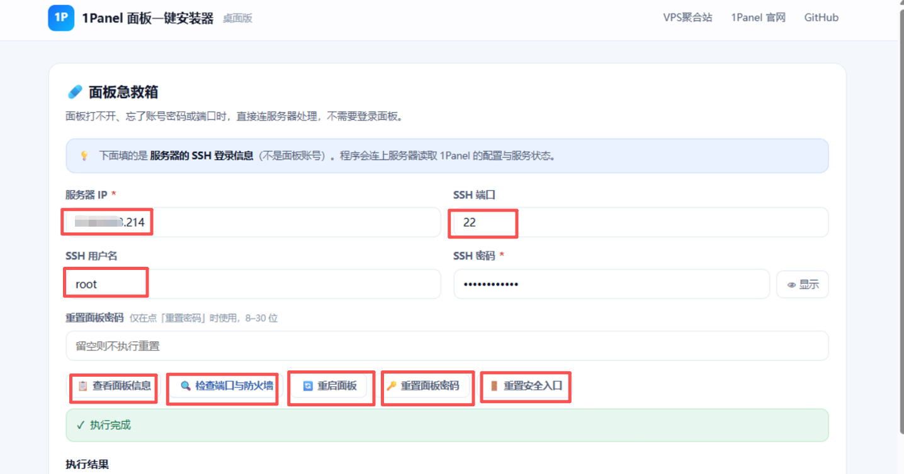

# 1Panel 面板一键安装器 · 桌面版

一个 Windows 桌面程序：填写服务器 IP、SSH 端口、root 密码，程序通过 SSH 自动识别系统类型、版本与
CPU 架构，匹配 1Panel 官方 v2 安装包，调用官方 `install.sh` 完成非交互安装，最后把面板地址、用户名、
密码直接交给你。支持中文版（国内源）与英文版（国际源）两种安装语言。

> 非官方工具，与 1Panel 官方无隶属关系。安装动作全部由 1Panel 官方安装脚本完成。
> 安装脚本来源：[1Panel-dev/1Panel](https://github.com/1Panel-dev/1Panel)。

## 功能

- **开始安装**：四步向导（服务器信息 → 安装配置 → 自动安装 → 安装完成）
- **面板急救箱**：查看面板信息、检查端口与防火墙、重启面板、重置密码、重置安全入口
- **域名与 HTTPS**：域名解析检查、面板访问协议与 HTTPS 状态读取
- **直接给我命令**：生成可复制的官方安装命令
- **独立窗口**：WinForms + 系统 WebView2，不占用浏览器、无控制台窗口
- **系统自适应**：识别 Ubuntu / Debian / CentOS / RHEL / Alma / Rocky / Fedora / openEuler /
  Anolis / OpenCloudOS / 麒麟 / UOS，按 CPU 架构匹配安装包
- **中英双语安装**：中文版走 `resource.fit2cloud.com` 国内源，英文版走 `resource.1panel.pro` 国际源，
  通过官方 `--lang zh|en` 参数设定
- **非交互安装**：使用官方 `install.sh` 的 `--non-interactive`、`--install-dir`、`--port`、
  `--entrance`、`--username`、`PANEL_PASSWORD`、`--install-docker`、`--docker-mode`、
  `--configure-accelerator`、`--replace-daemon-json` 参数
- **密码不进 argv**：面板密码通过 `PANEL_PASSWORD` 环境变量传入；日志中的密码替换为 `**********`

## 运行环境

- Windows 10 / 11（64 位）
- Microsoft Edge WebView2 Runtime（Win11 自带；缺失时程序提示下载地址）
- 目标服务器：Ubuntu 18.04+ / Debian 10+ / CentOS 7+ / RHEL 8+ / AlmaLinux 8+ / Rocky 8+ /
  Fedora / openEuler / Anolis / OpenCloudOS / 麒麟 / UOS
- 目标架构：amd64 / arm64 / armv7 / ppc64le / s390x / riscv64
- 目标服务器必须以 root 安装

## 使用

### 1. 解压并启动

下载 Release 压缩包并解压到任意目录，双击 `1Panel-Installer.exe`。



### 2. 填写服务器信息

首页选择「开始安装」，填写服务器 IP、SSH 端口、用户名和密码，点击「测试连接并识别系统」。



### 3. 确认系统识别结果

连接成功后会自动识别系统类型、版本、CPU 架构、内存与磁盘，并给出匹配的安装包架构；
系统不受支持或资源不足时会直接提示。



### 4. 选择安装语言并开始安装

在「安装配置」页选择 **中文版** 或 **English**，按需设置面板用户名、密码、端口、安全入口和
Docker 选项，然后点击「开始自动安装」。安装过程会实时显示服务器输出。

### 5. 安装完成并登录

安装完成后，到云控制台安全组放行面板端口（TCP），用程序给出的地址、用户名和密码登录 1Panel。



### 6. 面板急救箱

面板打不开、忘记账号密码或端口时，切换到「面板急救箱」，填写服务器 SSH 信息后即可查看面板信息、
检查端口与防火墙、重启面板、重置密码或重置安全入口。



## 工作原理

```
桌面窗口（WebView2 内核）
      │  本地回环 127.0.0.1:3942
内置 Node.js 服务（Express + Socket.IO + SSH2）
      │  SSH 加密直连
你的 VPS（下载 1Panel 官方 v2 安装包并执行 install.sh）
```

安装命令等价于官方流程：

```bash
BASE=https://resource.fit2cloud.com/1panel/package   # 中文版；英文版为 https://resource.1panel.pro
VERSION=$(curl -fsSL "$BASE/v2/stable/latest")
PKG="1panel-${VERSION}-linux-${ARCH}.tar.gz"
curl -fL -o "$PKG" "$BASE/v2/stable/${VERSION}/release/${PKG}"
tar zxf "$PKG" && cd "1panel-${VERSION}-linux-${ARCH}"
PANEL_NON_INTERACTIVE=1 PANEL_LANG=zh PANEL_PASSWORD='...' \
  bash install.sh --non-interactive --install-dir /opt --port 26888 \
  --entrance '...' --username 'admin' --install-docker y --docker-mode auto \
  --configure-accelerator y --replace-daemon-json n
```

## 目录结构

```
.
├── 1Panel-Installer.exe         # 桌面外壳（build.ps1 编译）
├── app/
│   ├── server.js                # 后端：SSH、系统识别、安装编排、急救箱
│   ├── public/index.html        # 前端界面（单文件）
│   ├── lib/linefeeder.js        # 终端行/进度分帧
│   └── node_modules/            # 预装依赖
├── desktop/Program.cs           # WinForms + WebView2 外壳源码
├── runtime/node.exe             # 内置 Node.js 20 LTS
├── build.ps1                    # 外壳编译脚本
├── 使用说明.txt
├── LICENSE
└── THIRD-PARTY-NOTICES.md
```

> **仓库与发行包的区别**：Git 仓库只保存源码与构建脚本，`app/node_modules/`、`runtime/`、
> WebView2 SDK DLL、编译后的 exe 和发行压缩包不进入版本库。普通用户请到
> [Releases](https://github.com/chenjun198711/1panel-install-desktop/releases) 下载完整绿色包。

## 从源码构建

```powershell
# 1) 依赖
cd app
npm install --omit=dev

# 2) 准备 WebView2 SDK 的 3 个 DLL（Microsoft.Web.WebView2.Core.dll、
#    Microsoft.Web.WebView2.WinForms.dll、WebView2Loader.dll）放在项目根目录
# 3) 准备 Node.js 20 运行时到 runtime\node.exe（或直接用本机 node 运行 app\server.js）
# 4) 编译桌面外壳（需要 .NET Framework 4.x 的 csc）
powershell -NoProfile -ExecutionPolicy Bypass -File .\build.ps1
```

`build.ps1` 调用：

```bat
csc -target:winexe -platform:x64 -optimize+ -codepage:65001 ^
  -r:System.dll -r:System.Drawing.dll -r:System.Windows.Forms.dll ^
  -r:Microsoft.Web.WebView2.Core.dll -r:Microsoft.Web.WebView2.WinForms.dll ^
  -out:1Panel-Installer.exe desktop\Program.cs
```

运行时不需要安装 Node.js：外壳会用 `runtime/node.exe` 启动 `app/server.js`，只监听
`127.0.0.1:3942`，关闭窗口即结束子进程。

## 安全提示

- 本地服务只监听 `127.0.0.1:3942`
- SSH 密码只存在于内存，不写盘、不上传第三方
- 面板密码通过环境变量传给官方脚本，日志显示已脱敏
- 仅供个人学习与合法用途，请只对自己有管理权限的服务器使用

## License

本项目代码以 [MIT License](LICENSE) 发布，Copyright (c) 2026 Jasson。
1Panel 安装脚本与面板本体遵循 GPLv3，详见 [THIRD-PARTY-NOTICES.md](THIRD-PARTY-NOTICES.md)。